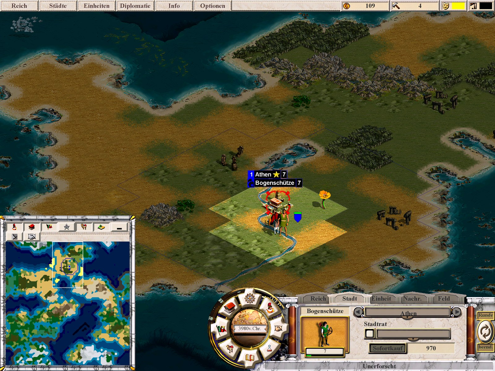
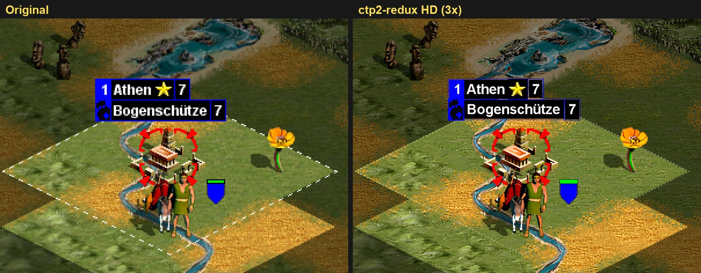
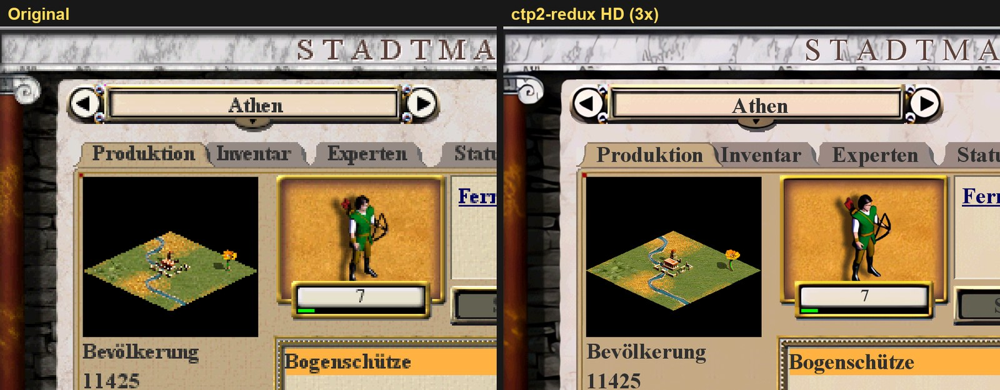
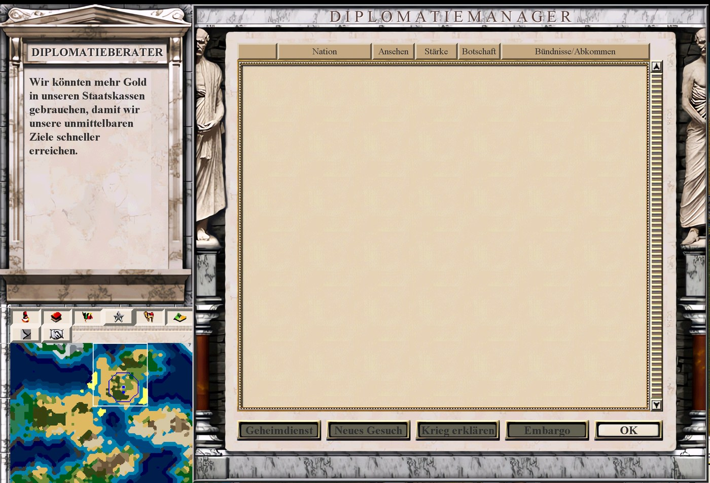
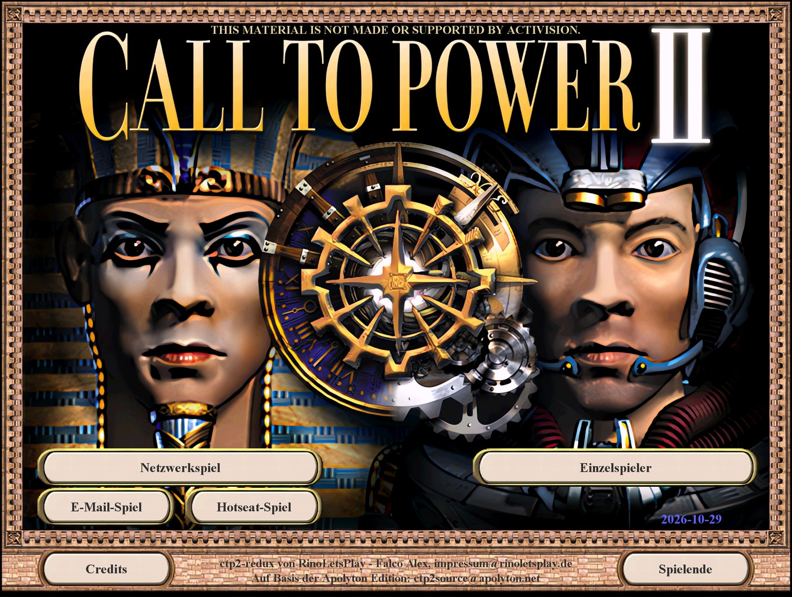

# ctp2-redux – Call to Power II for today's PCs

**[Deutsch](#deutsch)** · [Roadmap (PLAN.md)](PLAN.md)



ctp2-redux is a fork of the [Apolyton Call to Power II Source Code Project](https://github.com/civctp2/civctp2)
with four goals:

1. **Runs on modern Windows PCs** out of the box: 64-bit build, current
   Visual Studio toolchain, sharp pictures on high-resolution screens.
2. **Multiplayer that works again**: LAN and direct-IP internet games
   without the long-gone Activision lobby servers.
3. **Upscaled graphics and videos**: a setup that upscales the interface,
   terrain, units and videos of *your own copy* of the game on your own PC,
   plus the engine changes needed to show them.
4. **The developers' vision restored**: features the original developers
   planned and partly built, but never finished or never let the player
   see, are completed – only where the code and the game data prove what
   was intended, and in the look of the original game.

The game data is not included; you need your own copy of *Call to Power II*
(GOG or CD).

## Screenshots

Original pixels enlarged (left) and ctp2-redux at 3x with the upscaled
graphics (right), same map, same moment:





The **diplomatic advisor**, restored from the unfinished plans of the
original developers (see [below](#the-developers-vision-restored)):



The classic main menu of the original game:



*Screenshots of the German version. The HD pictures were made by the
setup from the author's own copy of the game; ctp2-redux does not ship
them.*

## Features

### Modern Windows

- 64-bit build with the Visual Studio 2022 Build Tools, no administrator
  rights needed.
- **Sharp scaling** for high resolutions (Options → Graphics): the game
  runs at the screen size divided by a whole factor (automatic: 4K →
  1920x1080 doubled) and is enlarged pixel by pixel instead of blurred.
  DPI aware with Windows display scaling.
- Videos play through FFmpeg.

### Multiplayer

- **Direct connection**: host or join by IP address, no lobby server. Host
  and client go straight from their profile to the game setup. 50+ rounds
  without a crash in manual tests; the network crashes AddressSanitizer
  found are fixed.
- Works over **IPv6** too (e.g. `[2001:db8::1]:21157`), for internet
  connections without a public IPv4 address (DS-Lite). The window shows
  your own IPv4 and IPv6 address with copy buttons.
- The network menu only offers what still works: direct connection,
  TCP/IP LAN, hotseat and e-mail (no IPX, no list of dead servers).
- **E-mail games**: after a turn the game offers to send the save game with
  your default mail program (Simple MAPI, e.g. Thunderbird or classic
  Outlook) or shows the file so you can send it yourself.

### HD graphics and videos

`tools/upscale/ctp2-redux-hochskalieren.bat` opens a setup (German or
English) that leads through game folder, scaling factor (2x, 3x or 4x; the
map gets HD pictures at 2x and 3x) and four
steps, each of which can be done on its own, cancelled and continued later –
so a slower PC can spread the work over several evenings:

1. **Interface** – windows, buttons, pictures.
2. **Videos** – frame by frame, H.264 through Windows Media Foundation
   (with an `ffmpeg.exe` built from the game's own FFmpeg).
3. **Terrain** – tiles, transitions, hills, rivers, roads.
4. **Units, cities and goods** – the game writes out their frames itself
   (`ctp2 spriteexport:<folder>`), the setup upscales them.

The upscaling runs locally with [Real-ESRGAN](https://github.com/xinntao/Real-ESRGAN)
(downloaded once from its GitHub release). The results go to
`ctp2_data/redux_hires/<factor>x`; the game then draws windows and text at
monitor resolution and takes these pictures. Nothing is shipped, deleting
`redux_hires` undoes it. Works with every language version, including the
German one with its own videos.

### Classic look

- **Classic interface** (on by default): the screens and windows of the
  original game from 2000 instead of the ones the Apolyton Edition
  redesigned (main menu, new game pop-ups, city window with tabs, domestic
  manager, diplomacy wizard, army manager), with the Apolyton additions
  fitted in. Switch it in Options → Graphics (takes effect at the next
  start).
- The bug fixes of the Apolyton Edition stay.

### The developers' vision restored

- **Diplomatic advisor**: the original game ships an unfinished
  intelligence window that cannot be opened – a placeholder picture
  instead of its background – with an advisor panel for the advice of your
  own diplomacy AI ("We should form alliances to strengthen our position",
  "The city of X is in danger of falling into enemy hands"). The game
  computed this advice every turn and all texts were translated, but the
  general advice was never shown. It now sits left of the diplomacy
  manager, framed like the trade and military advisors, and follows the
  nation selected in the list.

### German version

- Texts the Apolyton Edition left in English are translated.
- The German videos are used in a German game (they differ from the
  English ones).

## Getting started

A ready-to-play package is in preparation. Until then, build the game
yourself (the first build takes a while, FFmpeg is built too):

1. Install the **Visual Studio 2022 Build Tools** with the C++ workload and
   a Windows SDK.
2. Clone this repository.
3. Copy the folders `ctp2_data` and `Scenarios` of your installed game
   (e.g. `C:\GOG Games\Call To Power 2`) over your working copy **without
   replacing existing files**. With the GOG installer only, `innoextract -m
   -I app setup_call_to_power2_2.0.0.13.exe` unpacks them. From the CD, the
   videos are in `Setup/data/Max/ctp2_data/default/videos/`.
4. Optional, music: copy `ctp2_program/ctp/music` (the GOG tracks
   `Track02.ogg` … `Track11.ogg`) to `ctp2_code/ctp/music`.
5. Run `pwsh tools/win-build.ps1` in the repository root.
6. Start `ctp2_code/ctp/x64/ctp2.exe`. For a window instead of full screen,
   put `WindowedMode=Yes` into `ctp2_code/ctp/userprofile.txt`.
7. Optional: run `tools/upscale/ctp2-redux-hochskalieren.bat` for the HD
   graphics.

Save games of the GOG/CD version from `ctp2_program/ctp/save` can be copied
to `ctp2_code/ctp/save`.

## For developers

Work happens on the `redux` branch (default); `master` mirrors upstream.
The roadmap, findings from the code analysis and all decisions are in
[PLAN.md](PLAN.md). This fork is developed and tested on Windows only; the
Linux build files of upstream are still in the tree but not maintained.

### Building

`tools/win-build.ps1` finds Visual Studio, extracts NASM from `./NASM`,
copies the VC build targets to `_local` (installing them under Program
Files would need administrator rights), sets `CDKDIR` (bison/flex in
`bin`) and runs MSBuild on `ctp2_code/ctp/civctp.sln`. Default is
`Final-SDL` x64 → `ctp2_code/ctp/x64/ctp2.exe`; `-Config Debug-SDL` and
`-Platform Win32` are possible. It also builds `ffmpeg.exe` for the
upscaling setup. To get a PDB of the release build, set `LINK=/DEBUG`
before building.

The solution can also be opened in Visual Studio; use a `-SDL`
configuration and set `ctp2` as start project. The DirectX configurations
are left from upstream and not used.

### Automated tests

`tools/mptest.ps1` starts a host and a client of your build on the same PC.
They click through the network screens by themselves, play a
direct-connection game against each other and end their turns. No window
opens, the game is silent, nobody needs to click anything.

```
pwsh tools/mptest.ps1                    # 20 rounds, 2 AI civilisations
pwsh tools/mptest.ps1 -Turns 50 -AIPlayers 3
pwsh tools/mptest.ps1 -Show              # watch both game windows
pwsh tools/mptest.ps1 -ShotEvery 5       # screenshot every 5th round (0 = none)
pwsh tools/mptest.ps1 -Asan              # client built with AddressSanitizer
pwsh tools/mptest.ps1 -AnetLog           # network library with logging (dp.log)
pwsh tools/mptest.ps1 -JoinAddress '[::1]:21157'   # client joins over IPv6
pwsh tools/mptest.ps1 -Single -Turns 40  # single player run for comparison
pwsh tools/mptest.ps1 -Single -Tour -Scale 3 -Seed 7   # screenshots of all windows at 3x
```

The exit code is 0 if the test passed. A test passes when both instances
reach the requested round without a crash or a hang, there are no database
checksum (CRC) errors, the client never asked the host for a resync (its
game state never drifted), host and client log identical values (cities,
units, gold, advances) for the AI civilisations, and every map cell has
the same terrain on both at the end.

**What you get:** a summary in the console, and the folders
`ctp2_code/ctp/autotest_host`, `autotest_client` and `autotest_single`
(copies of the build, git-ignored) with:

- `autotest_log.txt`: steps, rounds, a stats line per player and round, a
  detail line (build queue, production, science, tax, government,
  population, research), resync and CRC events;
- `autotest_map_end.txt`: terrain and flags of every map cell at the end;
- `autotest_result.txt`: the machine-readable result;
- `autotest_round_<nnn>.png`: a screenshot of the own turn start, taken
  even while the window is hidden; with `-Tour`, `autotest_ui_*.png` of the
  menu screens and every game window.

**How it works:** the script passes command-line switches to the game,
implemented in `ctp2_code/ctp/ctp2_utils/autotest.cpp` and `autotour.cpp`:

| Switch | Meaning |
|---|---|
| `autohost` | host a direct-connection game |
| `autojoin=<addr>` | join the host at `<addr>`, e.g. `127.0.0.1:21157` |
| `autoturns=<n>` | stop after n rounds (default 20) |
| `autoai=<n>` | host only: number of AI civilisations (default 2) |
| `autohumans=<n>` | host only: human players to wait for (default 2) |
| `autoname=<name>` | player profile name |
| `autoshots=<n>` | screenshot every n rounds (default 1, 0 = none) |
| `autoplay=0` | test player only ends its turns (default: plays, see below) |
| `autosingle` | single player game (instant start), for comparison |
| `autotour` | screenshots of the menu screens and all game windows |
| `autoshow` | keep the window visible (hidden by default) |

The network windows press the same buttons a player would press. In the
game, each test player plays a simple turn: settlers found a city where
they stand if allowed, other units walk one step to a free neighbouring
tile (no attacks), every empty build queue gets a random buildable unit or
building, and research is picked at random if none is set. These actions
use the same game events as the keyboard and the city screen, so a
client's actions travel to the host exactly like real clicks. The random
choices come from the test's own random generator, never from the game's
(`CTP2_TEST_SEED` / `-Seed` fixes it, so a run makes the same map again).
In hidden mode the game uses a software renderer and edge scrolling is
off.

### Contributing

Coding style and tips are in the upstream [contributing guide lines](CONTRIBUTING.md).

## Game files and licence

*Call to Power II* is not free software. Activision released the source
code in 2003 for personal, non-commercial use only (see
[LICENSE.md](LICENSE.md)). The game data (graphics, videos, music, texts)
is **not** part of this repository and must come from your own copy of the
game ([GOG](https://www.gog.com/game/call_to_power_2) or CD). For the same
reason this project never distributes upscaled versions of the original
graphics or videos, only the scripts that make them locally from your own
installation.

## Credits

- [Apolyton CTP2 Source Code Project](https://github.com/civctp2/civctp2) –
  the base of this fork, with years of bug fixes, the SDL port and the 64-bit
  code ([forum](https://apolyton.net/forum/other-games/call-to-power-2/ctp2-source-code-project),
  latest release [Apolyton Edition 2025-01-20](https://github.com/civctp2/civctp2/releases/tag/Apolyton-Edition-2025-01-20)).
- Activision, for releasing the source code.
- Original readme files: [Activision](Activision%20CTP2%20Source%20Code_Readme.txt),
  [Apolyton](Apolyton%20CTP2%20Source%20Code_Readme.txt).

### Included libraries

These third-party libraries are part of the repository; their own licences
apply:

| Library | Type | Readme | Licence | Web site |
|---|---|---|---|---|
| Anet | Source | [Readme](./ctp2_code/libs/anet/README.md) | [LGPL](./ctp2_code/libs/anet/LICENSE) | |
| FFmpeg-n6.1.2 | Source | [Readme](./ctp2_code/libs/FFmpeg-n6.1.2/README.md) | [Licences](./ctp2_code/libs/FFmpeg-n6.1.2/LICENSE.md) | [ffmpeg.org](https://ffmpeg.org/download.html#releases) |
| Freetype-1.3.1 | Source | [Readme](./ctp2_code/libs/freetype-1.3.1/README) | [FreeType Project](./ctp2_code/libs/freetype-1.3.1/license.txt) | [freetype.org](https://freetype.org/download.html) |
| SDL2_image-2.8.8 | Library | [Readme](./ctp2_code/libs/SDL2_image-2.8.8/README.txt) | [Custom](./ctp2_code/libs/SDL2_image-2.8.8/LICENSE.txt) | [GitHub](https://github.com/libsdl-org/SDL_image/releases) |
| SDL2_mixer-2.8.1 | Library | [Readme](./ctp2_code/libs/SDL2_mixer-2.8.1/README.txt) | [Custom](./ctp2_code/libs/SDL2_mixer-2.8.1/LICENSE.txt) | [GitHub](https://github.com/libsdl-org/SDL_mixer/releases) |
| SDL2-2.30.12 | Library | [Readme](./ctp2_code/libs/SDL2-2.30.12/README.md) | [Custom](./ctp2_code/libs/SDL2-2.30.12/LICENSE.txt) | [GitHub](https://github.com/libsdl-org/SDL/releases) |
| Tiff-4.7.0 | Source | [Readme](./ctp2_code/libs/tiff-4.7.0/README.md) | [LibTIFF](./ctp2_code/libs/tiff-4.7.0/LICENSE.md) | [libtiff](https://libtiff.gitlab.io/libtiff/releases/index.html) |
| Zlib-1.3.1 | Source | [Readme](./ctp2_code/libs/zlib-1.3.1/README) | [zlib](./ctp2_code/libs/zlib-1.3.1/LICENSE) | [GitHub](https://github.com/madler/zlib/releases) |
| Nasm-2.16.03 | Win x64 binary | | [Inside zip file](./NASM/nasm-2.16.03-win64.zip) | [nasm.us](http://www.nasm.us/pub/nasm/releasebuilds) |
| Byacc | Win x86 binary | [Readme](./bin/byacc-README) | Public domain | [invisible-island.net](https://invisible-island.net/byacc) |
| Flex-2.5.4 | Win x86 binary | | [Custom](./bin/flex-COPYING) | [GitHub](https://github.com/westes/flex/releases) |
| Win-Linux-Tools | Win x86 binaries | | [GNU GPL](./bin/GNUGeneralPublicLicence2.txt) | |

Real-ESRGAN is not included; the upscaling setup downloads it from its
GitHub release when needed.

---

## Deutsch

**ctp2-redux** ist ein Fork des [Apolyton Call to Power II Source Code Project](https://github.com/civctp2/civctp2)
mit vier Zielen:

1. **Läuft auf heutigen Windows-PCs** ohne Bastelei: 64-Bit-Build, aktuelle
   Visual-Studio-Werkzeuge, scharfe Bilder auf hochauflösenden Bildschirmen.
2. **Multiplayer, der wieder funktioniert**: LAN- und Internet-Spiele per
   direkter IP, ohne die längst abgeschalteten Activision-Lobbyserver.
3. **Hochskalierte Grafik und Videos**: ein Einrichtungsassistent, der
   Oberfläche, Gelände, Einheiten und Videos *der eigenen Spielkopie* auf
   dem eigenen PC hochskaliert, plus die nötigen Änderungen in der Engine.
4. **Die Vision der Entwickler wiederhergestellt**: Funktionen, die die
   ursprünglichen Entwickler geplant und teils schon gebaut, aber nie fertig
   gemacht oder dem Spieler nie gezeigt haben, werden vervollständigt – nur
   wo Code und Spieldaten belegen, was gemeint war, und in der Optik des
   Originals.

Die Spieldaten sind nicht enthalten; man braucht eine eigene Kopie von
*Call to Power II* (GOG oder CD). Die Bilder oben zeigen die deutsche
Fassung: links das Original mit vergrößerten Pixeln, rechts ctp2-redux in
3x mit den hochskalierten Grafiken.

### Funktionen

**Heutiges Windows**
- 64-Bit-Build mit den Visual Studio 2022 Build Tools, ohne Adminrechte.
- **Scharfe Skalierung** (Optionen → Grafik): Das Spiel rechnet in
  Bildschirmgröße geteilt durch einen ganzen Faktor (automatisch: 4K →
  1920x1080 verdoppelt) und wird Pixel für Pixel vergrößert statt
  weichgezeichnet. Beachtet die Windows-Anzeigeskalierung.

**Multiplayer**
- **Direktverbindung**: Hosten oder Beitreten per IP-Adresse, ohne
  Lobbyserver; Host und Client kommen vom Profil direkt ins Spiel-Setup. In
  Handtests über 50 Runden ohne Absturz.
- Auch über **IPv6** (z.B. `[2001:db8::1]:21157`), für Anschlüsse ohne
  öffentliche IPv4-Adresse (DS-Lite); das Fenster zeigt die eigene IPv4-
  und IPv6-Adresse mit Kopierknöpfen.
- Das Netzwerkmenü bietet nur noch, was funktioniert: Direktverbindung,
  TCP/IP-LAN, Hotseat und E-Mail.
- **E-Mail-Spiele**: Nach dem Zug bietet das Spiel an, den Spielstand mit
  dem Standard-Mailprogramm zu verschicken (z.B. Thunderbird oder
  klassisches Outlook) oder zeigt die Datei zum selbst Verschicken.

**HD-Grafik und Videos**
- `tools/upscale/ctp2-redux-hochskalieren.bat` öffnet einen
  Einrichtungsassistenten (Deutsch oder Englisch) mit Spielordner, Faktor
  (2x, 3x oder 4x; die Karte bekommt bei 2x und 3x HD-Bilder) und vier Schritten, die sich einzeln erledigen, abbrechen und
  später fortsetzen lassen – ein langsamer PC kann sich die Arbeit auf
  mehrere Abende verteilen: 1 Oberfläche, 2 Videos, 3 Gelände, 4 Einheiten,
  Städte und Güter.
- Hochskaliert wird lokal mit Real-ESRGAN (einmalig von dessen GitHub-Seite
  geladen) nach `ctp2_data/redux_hires/<Faktor>x`. Wir verteilen nichts,
  `redux_hires` löschen macht es rückgängig. Funktioniert mit jeder
  Sprachfassung, auch mit der deutschen und ihren eigenen Videos.

**Klassische Optik**
- **Klassische Oberfläche** (Standard an): die Bildschirme und Fenster des
  Originals von 2000 statt der von der Apolyton Edition umgestalteten, mit
  den Apolyton-Ergänzungen darin. Umschalten unter Optionen → Grafik.
- Die Fehlerbehebungen der Apolyton Edition bleiben.

**Die Vision der Entwickler wiederhergestellt**
- **Diplomatieberater**: Das Original enthält ein unfertiges
  Geheimdienstfenster, das sich nicht öffnen lässt – ein Platzhalterbild
  statt Hintergrund – mit einer Berater-Leiste für die Ratschläge der
  eigenen Diplomatie-KI („Wir sollten Allianzen schließen, um unsere
  Position zu stärken“, „Die Stadt X läuft Gefahr, in die Hände des Feindes
  zu fallen“). Das Spiel hat diese Ratschläge jede Runde berechnet und alle
  Texte waren übersetzt, nur der allgemeine Rat wurde nie gezeigt. Jetzt
  steht er links am Diplomatiemanager, gerahmt wie Handels- und
  Militärberater, und folgt der in der Liste gewählten Nation.

**Deutsche Fassung**
- Texte, die die Apolyton Edition auf Englisch gelassen hat, sind übersetzt.
- Im deutschen Spiel laufen die deutschen Videos (sie unterscheiden sich
  von den englischen).

### Loslegen

Ein fertiges Spielpaket ist in Vorbereitung. Bis dahin baut man das Spiel
selbst (der erste Build dauert eine Weile, FFmpeg wird mitgebaut):

1. **Visual Studio 2022 Build Tools** mit C++-Workload und Windows SDK
   installieren.
2. Repository klonen.
3. Die Ordner `ctp2_data` und `Scenarios` des installierten Spiels (z.B.
   `C:\GOG Games\Call To Power 2`) über die Arbeitskopie kopieren, **ohne
   vorhandene Dateien zu ersetzen**.
4. Optional, Musik: `ctp2_program/ctp/music` (die GOG-Titel `Track02.ogg`
   … `Track11.ogg`) nach `ctp2_code/ctp/music` kopieren.
5. `pwsh tools/win-build.ps1` im Hauptordner ausführen.
6. `ctp2_code/ctp/x64/ctp2.exe` starten. Für ein Fenster statt Vollbild
   `WindowedMode=Yes` in `ctp2_code/ctp/userprofile.txt` eintragen.
7. Optional: `tools/upscale/ctp2-redux-hochskalieren.bat` für die HD-Grafik.

Spielstände der GOG-/CD-Fassung aus `ctp2_program/ctp/save` lassen sich
nach `ctp2_code/ctp/save` kopieren.

### Für Entwickler

Bauen, automatische Tests (Multiplayer-Test und Bildschirmtour mit
`tools/mptest.ps1`) und die Kommandozeilen-Schalter stehen im englischen
Teil [oben](#for-developers). Fahrplan, Erkenntnisse und Entscheidungen
stehen in [PLAN.md](PLAN.md).

### Spieldaten und Lizenz

*Call to Power II* ist keine freie Software. Activision hat den Quellcode
2003 ausschließlich für den persönlichen, nicht-kommerziellen Gebrauch
freigegeben (siehe [LICENSE.md](LICENSE.md)). Die Spieldaten (Grafik,
Videos, Musik, Texte) sind **nicht** Teil dieses Repositories und müssen aus
der eigenen Kopie des Spiels stammen. Aus demselben Grund verteilt dieses
Projekt keine hochskalierten Fassungen der Originalgrafiken oder -videos,
sondern nur die Skripte, die sie lokal aus der eigenen Installation
erzeugen.
